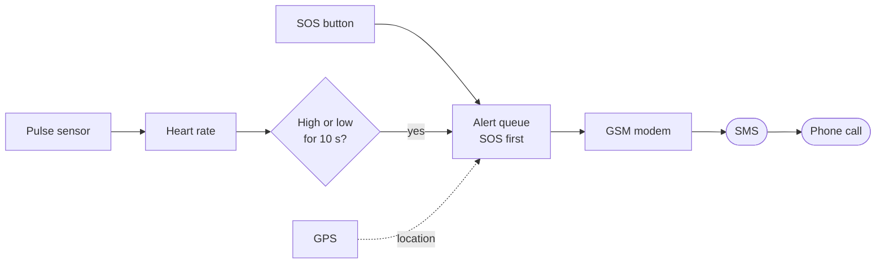

# HeartSaver: ESP32 Health & Safety Tracker

A wearable built on the ESP32 that watches heart rate and location, and alerts an emergency contact by SMS and phone call when something looks wrong. It works over the cellular network, so it needs no Wi-Fi and no phone nearby.

Built for the UTHM Integrated Design Project (Smart Healthcare). Proposal title: *HeartSaver: IoT-Based Emergency Response System for Heart Attacks with Wearable Health Monitoring*.

> **Not a medical device.** It is an alerting aid, not a validated heart-attack detector. It can miss events and raise false alarms. In an emergency, call your local emergency number.

## How it works



An alert SMS looks like this:

```
ALERT: SOS - manual button press
BPM: 88
https://maps.google.com/?q=5.421234,100.336789
```

| Alert | Trigger | Phone call |
|---|---|---|
| SOS | Button press. Sent at once, even without a GPS fix. | Yes |
| Low BPM | Below 50 for 10 s. A lifted sensor reads 0 and never triggers it. | Yes |
| High BPM | Above 90 for 10 s, then a 5 min cooldown. | Yes |
| GPS fix | First valid fix after boot (optional). | No |

Thresholds, calls and timings are all configurable. See [docs/configuration.md](docs/configuration.md).

## What you need

| Part | Notes |
|---|---|
| ESP32 Dev Module (38-pin) | Not an ESP8266. The firmware won't run on one. |
| Analog pulse sensor | On ADC pin GPIO 36 |
| NEO-6M GPS module | With antenna |
| SIM800L or SIM900 GSM module | With antenna |
| SIM card | Active, with SMS and call credit, PIN lock disabled |
| Tactile switch | SOS button |
| Separate 3.7–4.2 V supply for the GSM module | Must deliver about 2 A peaks. Do not power it from the ESP32. |

Wiring and pinout: [docs/hardware.md](docs/hardware.md).

> **Check 2G coverage first.** The SIM800L is a 2G-only module, and many countries have shut down 2G networks. Confirm your carrier still offers 2G where you will use it. Otherwise the SMS and call features cannot work, and you would need a 4G module (such as a SIM7600) and driver changes.

## Quick start

Requires [PlatformIO](https://platformio.org/). The project is not set up for the Arduino IDE.

```sh
git clone https://github.com/sritulasiram/esp32-health-tracker.git
cd esp32-health-tracker
cp include/config.example.h include/config.h   # set ALERT_PHONE_NUMBER, then pins and thresholds
pio run -t upload
pio device monitor                              # 115200 baud
```

Wait for `[GSM] registered, ready`, then press the SOS button to send a test alert. Step-by-step setup is in the [user guide](docs/user-guide.md).

`include/config.h` is gitignored. Never commit a real phone number.

## Limitations

- **Single contact.** One phone number, compiled into the firmware.
- **Heart-attack detection is not validated.** It reacts to sustained high or low pulse rate. It does not detect irregular rhythm. A pulse that stops entirely looks the same as a lifted sensor and does not raise an alert.
- **Needs cellular coverage.** In poor coverage an alert is retried a few times, then dropped.
- **Not in this repository** (from the proposal): cloud data upload, the Android app, Wi-Fi location, schematic/PCB and enclosure files. The exact status of every proposal item is in [docs/project-context.md](docs/project-context.md).

## Status

| Check | State |
|---|---|
| Host unit tests (`make -C tests`) | Pass, including the GSM driver and call logic against a simulated modem |
| Firmware build for `esp32dev` | Compiles and links (7% RAM, 21% flash) |
| Real pulse sensor | Not tested. Heart-rate logic has only seen synthetic signals. |
| Real GSM module (SMS) | Not tested |
| Phone call feature | Not tested on any real modem |

Expect to tune `PULSE_MIN_AMPLITUDE` and `GSM_BAUD` for your parts. The hardware evaluation plan is in [docs/testing.md](docs/testing.md).

## Documentation

| Page | Contents |
|---|---|
| [docs/user-guide.md](docs/user-guide.md) | Setup, wearing it, what each alert means, limits |
| [docs/hardware.md](docs/hardware.md) | Components, pinout, wiring, power notes |
| [docs/configuration.md](docs/configuration.md) | Every `config.h` setting |
| [docs/architecture.md](docs/architecture.md) | Firmware design, heart-rate algorithm, modem state machine |
| [docs/development.md](docs/development.md) | Build, tests, serial output, troubleshooting |
| [docs/testing.md](docs/testing.md) | Automated tests and the hardware evaluation plan |
| [docs/project-context.md](docs/project-context.md) | Proposal summary and proposal-versus-repo status |
| [CONTRIBUTING.md](CONTRIBUTING.md) | How to contribute |
| [CHANGELOG.md](CHANGELOG.md) | What changed from v1 |

## Repository layout

```
src/               Arduino glue: main.cpp (wiring), serial_port.h (UART adapter)
lib/tracker_core/  Pure C++, no Arduino dependency: heart rate, alerts, debounce, AT modem
include/           config.example.h (copy to config.h)
tests/             Host unit tests for lib/tracker_core
docs/              Documentation
.github/           CI: host tests and firmware build
legacy/            v1 sketches, kept for reference
```

## License

MIT. See [LICENSE](LICENSE).
