# Architecture

## System overview

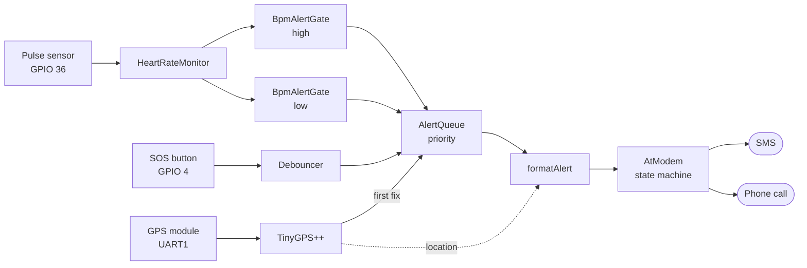

`main.cpp` wires these together in a single non-blocking `loop()`. Nothing calls `delay()`.

## Main loop

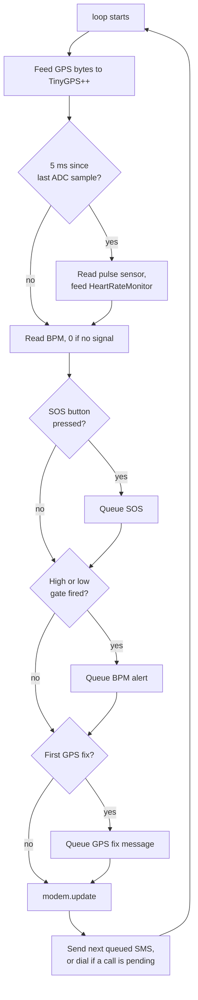

## Code split

| Location | Role | Arduino dependency |
|---|---|---|
| `lib/tracker_core/heart_rate.h` | `HeartRateMonitor`, `BpmAlertGate` | none |
| `lib/tracker_core/alert.h` | `Alert`, `AlertQueue`, `formatAlert` | none |
| `lib/tracker_core/debounce.h` | `Debouncer` | none |
| `lib/tracker_core/at_modem.h` | AT-command state machine, templated on the serial port | none |
| `src/serial_port.h` | Adapts `HardwareSerial` to the modem's port interface | yes |
| `src/main.cpp` | Sensor loop and alert plumbing | yes |

The pure logic is kept separate so it can be unit tested on a computer. `AtModem` takes the serial port as a template parameter, so tests drive it with a fake modem instead of real hardware.

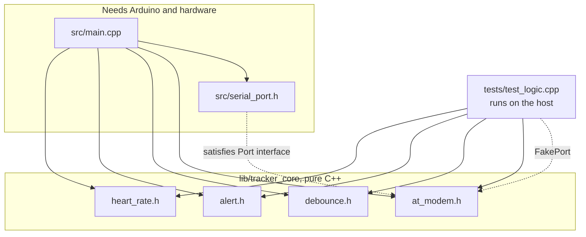

## Heart rate

1. Sample the ADC every 5 ms.
2. Every 2 s, take the min and max of the window. The thresholds sit at 40% and 60% of that range, so they follow the signal.
3. If the range is below `PULSE_MIN_AMPLITUDE`, treat it as no signal.
4. A rising crossing of the upper threshold is a beat. Crossings within 300 ms of the last beat are ignored.
5. BPM is `60000 / average` of the last 8 inter-beat intervals. It needs at least 4 intervals, and reports 0 if no beat for 3 s.

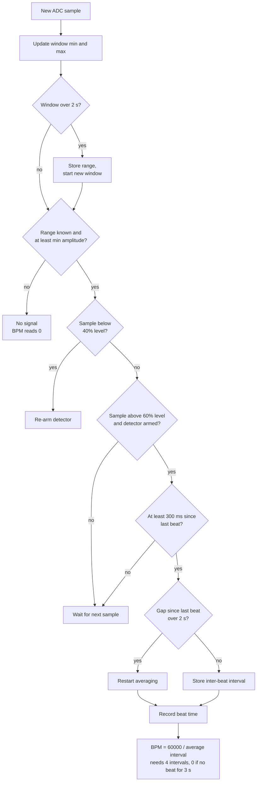

## Alert gates

`BpmAlertGate` fires once when BPM stays beyond a limit for a sustained time: above it for the high gate, below it for the low gate. It re-arms after BPM recovers past `limit ∓ hysteresis`, and enforces a cooldown. A reading of 0 (no signal) is never a breach, so a lifted sensor cannot raise a low-BPM alert. The shortest measurable rate is about 30 BPM, since a gap over 2 s restarts averaging.

With the defaults, BPM falls into these zones:

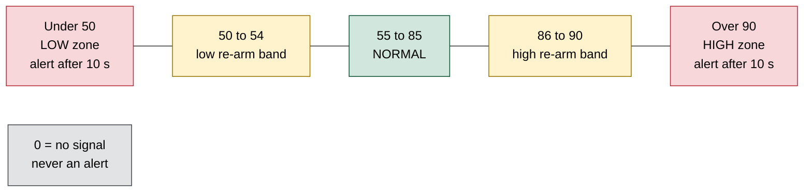

In a re-arm band the gate keeps its current state. The sustain timer is not reset, and a fired gate stays disarmed. Each gate is a small state machine:

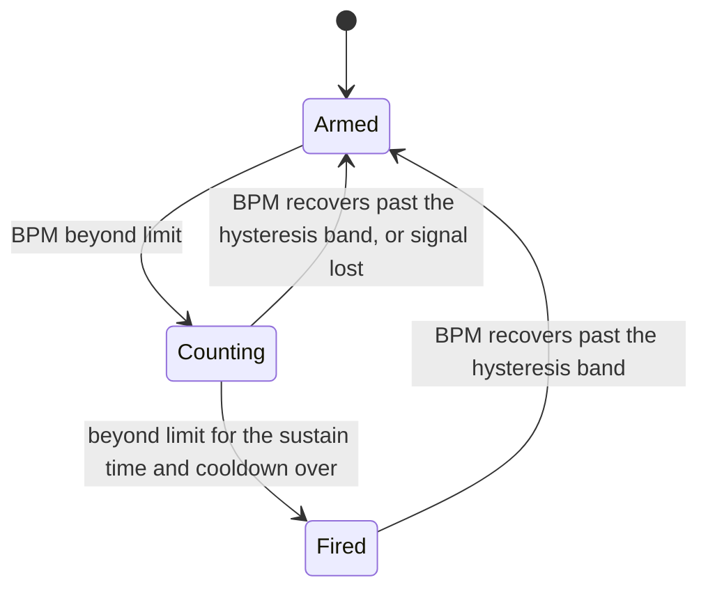

## Alert queue

Four slots, highest priority first (SOS, low BPM, high BPM, then GPS fix), FIFO within a priority. When full, the oldest lowest-priority entry is evicted. An incoming alert is dropped only if everything queued outranks it.

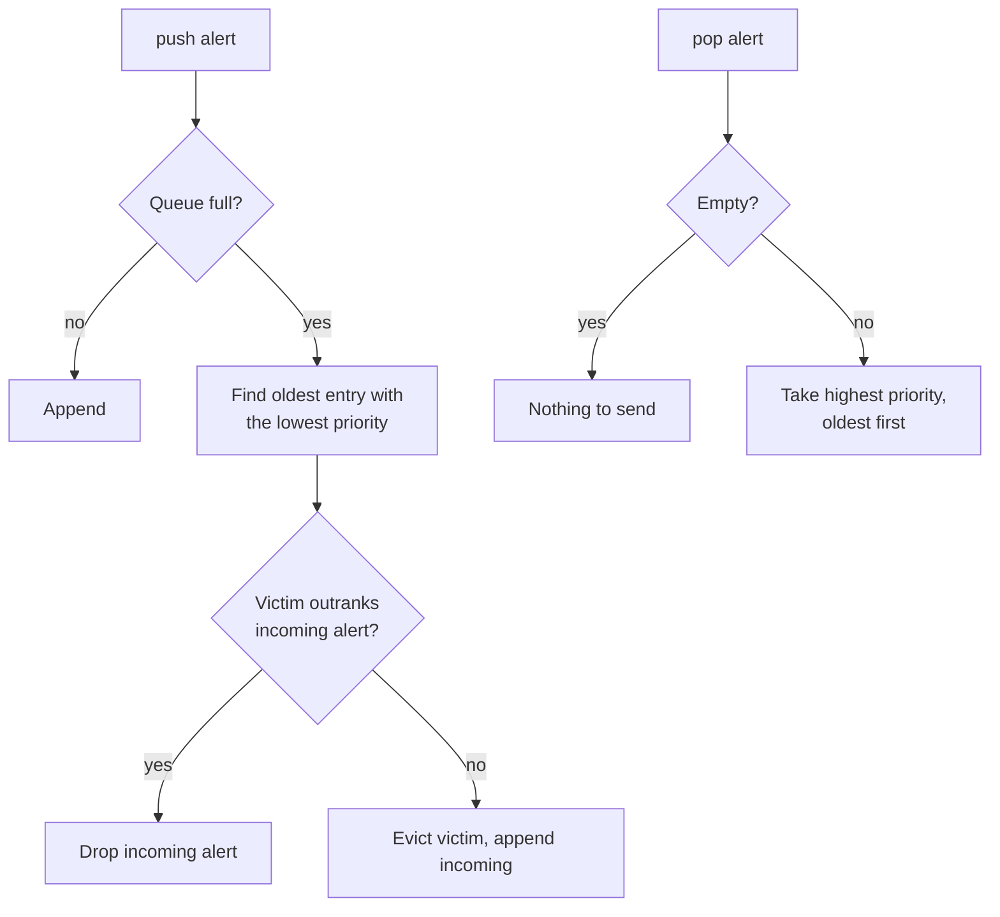

## GSM modem

### Start-up

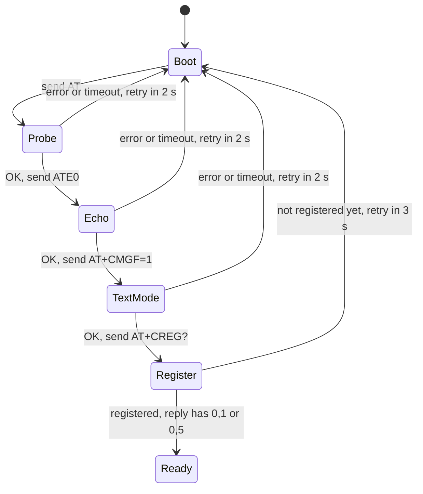

### Sending an SMS

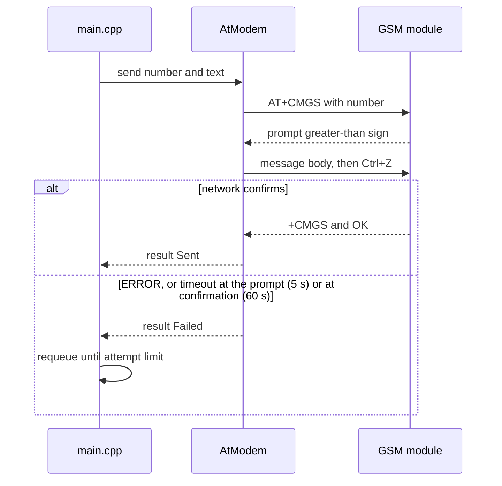

- Replies accumulate in a buffer, so a reply split across loop passes is still matched.
- A step succeeds on its expected token (`OK`, `>`, `+CMGS:`), fails on `ERROR`, and fails on timeout. A timeout is never reported as success.
- A failed send is re-queued, up to the attempt limits in `config.h`.

### Phone call

After an alert SMS is sent, `main.cpp` sets a call-pending flag for the alert types enabled by `CALL_ON_SOS` / `CALL_ON_BPM`. When the SMS queue is empty, the modem dials.

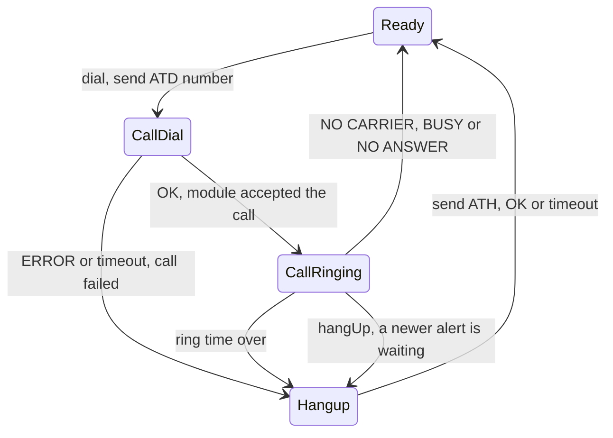

- If a new alert is queued while ringing, `hangUp()` drops the call so the SMS is not delayed.
- Several alerts in a row produce one call, not one each.
- The call is best effort: a failed call is logged and not retried. The SMS is the reliable channel.

### How an alert flows end to end

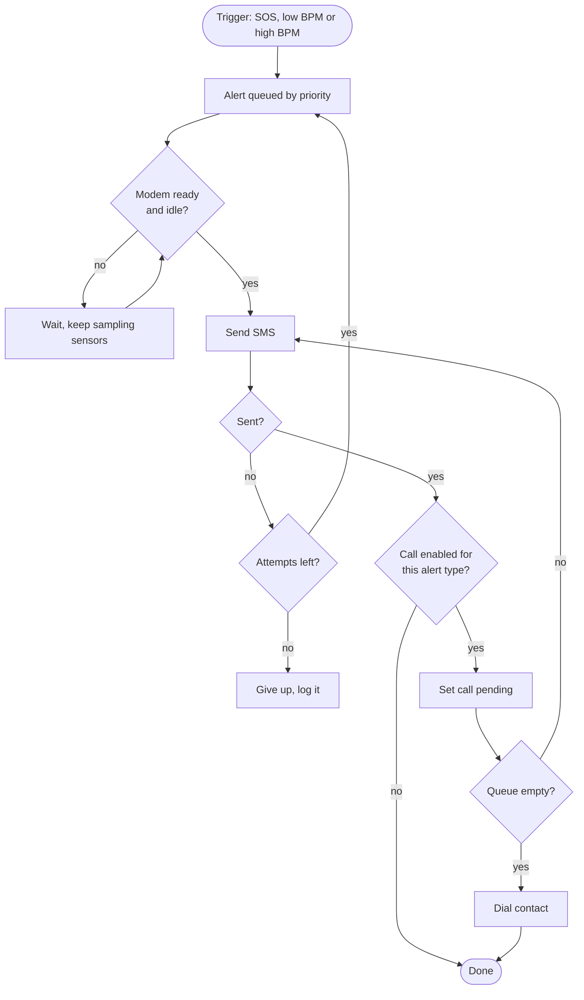

## SMS format

A single-part SMS under 160 characters:

```
ALERT: SOS - manual button press
BPM: 88
https://maps.google.com/?q=5.421234,100.336789
```

Without a fix the last line is `Location unknown (no GPS fix)`. A fix older than `LOCATION_STALE_MS` is prefixed with `Last known:`.
