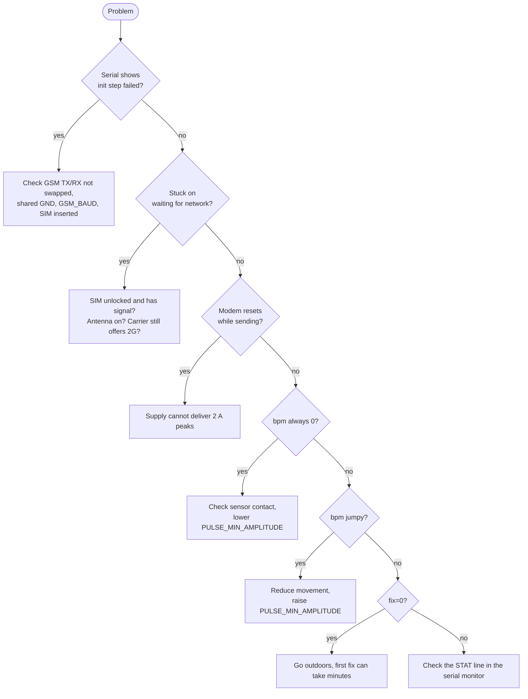

# Development

## Build and flash

```sh
cp include/config.example.h include/config.h
pio run                 # build
pio run -t upload       # flash
pio device monitor      # serial at 115200
```

Dependency: TinyGPSPlus, installed automatically by PlatformIO from `platformio.ini`.

## Tests

The logic in `lib/tracker_core` has host unit tests and needs only a C++17 compiler:

```sh
make -C tests
```

They cover the heart-rate detector (including signal loss and noise), the BPM alert gate, the debouncer, the alert queue priority and eviction, SMS formatting, and the modem state machine against a fake modem: init, fragmented replies, no network, `ERROR` at the prompt, and the send timeout. The Arduino glue in `src/` (`main.cpp`, `serial_port.h`) is only checked by compiling it.

CI (`.github/workflows/ci.yml`) runs the host tests and `pio run` on every push.

## Serial output

```
[BOOT] ESP32 health tracker
[GSM] > AT
[GSM] registered, ready
[ALERT] queued: SOS - manual button press
[GSM] > AT+CMGS="+10000000000"
[GSM] SMS sent
[STAT] bpm=74 fix=1 sats=7 gsm=ready queued=0
```

`[STAT]` prints every 5 s. `bpm=0` means no trustworthy reading.

## Troubleshooting



The same causes as a table:

| Symptom | Check |
|---|---|
| Stuck at `init step failed` | GSM wiring (TX/RX crossed?), shared GND, `GSM_BAUD`, SIM inserted |
| `waiting for network` forever | SIM has signal and is unlocked (no PIN), antenna attached |
| `waiting for network` forever, signal fine | The carrier may have shut down 2G. See [hardware.md](hardware.md#cellular-network) |
| Modem resets while sending | Power supply cannot supply 2 A peaks |
| `bpm` always 0 | Sensor contact, `PULSE_MIN_AMPLITUDE` too high |
| `bpm` jumpy | Sensor movement, `PULSE_MIN_AMPLITUDE` too low |
| `fix=0` indoors | GPS needs sky view; first fix can take minutes |

## Not yet done

- On-device verification: real pulse sensor, real GSM module, real SOS SMS.
- Schematic, PCB and enclosure files (see [hardware.md](hardware.md)).
