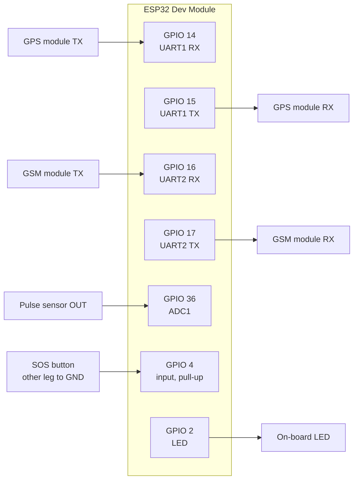
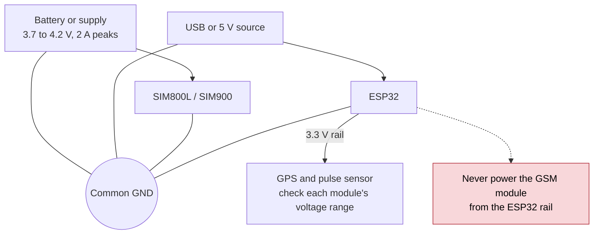

# Hardware

## Components

| Component | Module | Interface |
|---|---|---|
| Microcontroller | ESP32 Dev Module (38-pin) | |
| GPS | NEO-6M or compatible | UART1, 9600 baud |
| GSM | SIM800L or SIM900 | UART2 (`Serial2`), 19200 baud |
| Pulse sensor | Analog pulse sensor | ADC1 |
| SOS button | Tactile switch | Digital input, `INPUT_PULLUP` |
| LED | On-board | Digital output, on while an SMS is sending |

## Pinout

| Signal | ESP32 pin | Connects to |
|---|---|---|
| GPS RX | GPIO 14 | GPS TX |
| GPS TX | GPIO 15 | GPS RX |
| GSM RX | GPIO 16 | GSM TX |
| GSM TX | GPIO 17 | GSM RX |
| Pulse sensor | GPIO 36 | Sensor OUT |
| SOS button | GPIO 4 | Button, other leg to GND |
| LED | GPIO 2 | On-board LED |

UART lines cross over: each module's TX goes to an ESP32 RX pin. All grounds must be shared.

Pins are defined in `include/config.h`. GPIO 36 is input-only and on ADC1, so it keeps working if WiFi is ever enabled.

## Power

A SIM800L draws up to 2 A in short peaks while transmitting. Power it from a dedicated 3.7–4.2 V supply that can deliver that current, not from the ESP32 3.3 V rail. A weak supply shows up as the modem resetting during an SMS.

## Cellular network

The SIM800L is a **2G-only** module (SIM900 is also 2G). Many countries have shut down 2G, and SMS and calls then fail even though the firmware and wiring are correct. Check that your carrier still offers 2G where the device will be used. If not, a 4G module (for example SIM7600) is needed, and the AT driver in `lib/tracker_core/at_modem.h` would need review, since command sets differ.

## Design deliverables

The IDP asks for schematic/PCB drawings and an enclosure, and the proposal plans circuit simulation in Proteus 8. None of these are in this repo yet. When added, put them under `hardware/` (Proteus project, schematic, PCB, CAD/3D) and link them here.

The proposal's schedule mentions a NodeMCU ESP8266. This firmware targets the **ESP32** and does not run on an ESP8266.
