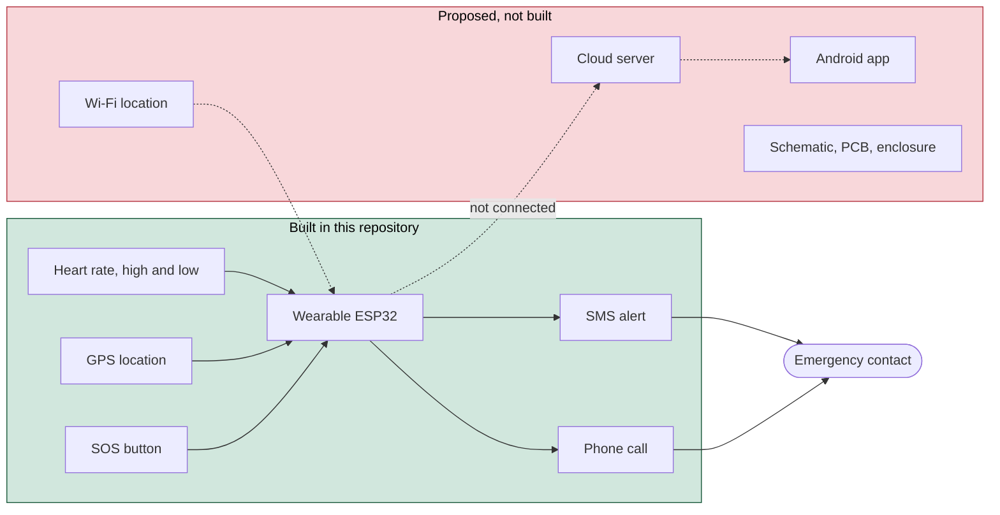

# Project context: HeartSaver

This repository is the firmware for **HeartSaver: IoT-Based Emergency Response System for Heart Attacks with Wearable Health Monitoring**, a UTHM Integrated Design Project (BEE40803, Smart Healthcare theme). This page summarises the proposal and states, requirement by requirement, what the repository does and does not deliver.

## Problem

Heart attacks are a leading cause of death. During one, a person may panic or be unable to call for help, which delays treatment and raises the risk of death or disability. HeartSaver is a wearable that watches heart rate and location and alerts pre-defined emergency contacts.

## Objectives (from the proposal)

1. Design an IoT system for rapid communication between a person in a medical emergency and their emergency contacts.
2. Build a wearable that collects vital signs and transmits them to a cloud server, with review in an Android app.
3. Evaluate automatic alerts, data transmission accuracy, and app usability.

## Scope and limitations (from the proposal)

- Heart-attack detection only. No other conditions.
- Accuracy depends on the sensor and algorithm and is **not guaranteed**. Communication depends on network and GPS availability.
- Assumes users wear and use the device as intended. The proposal does not address privacy, security, comfort or preference.

> **Not a medical device.** The pulse sensor and threshold logic here are an alerting aid, not a validated heart-attack detector. They can miss events and raise false alarms. Do not rely on this device for medical decisions.

## Proposal versus this repository

The detailed table:

| Proposal item | Status | Notes |
|---|---|---|
| Wearable with heart-rate sensor | Done | Analog pulse sensor on an ESP32. See [hardware.md](hardware.md). |
| GPS location tracking | Done | NEO-6M on UART1. |
| Alert pre-defined contacts with location | Done, SMS | One recipient, set in `config.h`. Alerts carry a Google Maps link. |
| Manual emergency trigger | Done | SOS button, highest priority. Not in the proposal, added for safety. |
| Alert when heart rate leaves the normal range | Done | Sustained **low** BPM (the proposal flowchart) and sustained **high** BPM. A pulse that stops entirely reads as no signal, so it cannot be told apart from a lifted sensor. |
| Automatic phone call | Done, untested on hardware | After the alert SMS, the modem rings the contact (`ATD`) and hangs up after 25 s. Configurable per alert type. |
| Wi-Fi triangulation for location | **Not implemented** | GPS only. |
| Transmit vitals to a cloud server | **Not implemented** | The device has no internet link. Alerts go over SMS only. |
| Android app (health updates, contact management) | **Not implemented** | Out of this repository. The contact number is compiled in. |
| Connectivity redundancy (proposal recommendation 3) | Partly | Cellular SMS works without Wi-Fi or a phone nearby. There is no second channel if the cellular network is down. |
| Schematic and PCB design (Proteus) | Not in repo | See [hardware.md](hardware.md). |
| Enclosure | Not in repo | |
| Evaluation of alert reliability, data accuracy, usability | Not yet done | A plan is in [testing.md](testing.md). |

One inconsistency in the proposal's schedule: it mentions a NodeMCU ESP8266, while its methodology and this firmware use an **ESP32**. The firmware does not run on an ESP8266, which has a single hardware serial port and one ADC channel.

## STEEP summary

| Factor | Summary from the proposal |
|---|---|
| Social | Digital health lets clinicians and family follow symptoms through smartphones, improving patient outcomes. |
| Technological | ESP32 programmed in the Arduino/PlatformIO ecosystem, with GPS tracking. |
| Economic | Components are cheap and easy to buy online or locally. Most people already own a phone. |
| Environmental | IoT makes health monitoring more accessible. |
| Political | Consumer-protection and regulation factors apply to health devices. |

The full analysis is in the proposal report, which is kept outside this repository.

## What this repository implements

- Reliable SMS alerting with retries, priority and a non-blocking modem driver.
- Automatic phone call after an alert, which yields to a newer alert's SMS.
- A heart-rate detector with signal-loss handling, and high and low rate alerts.
- Unit tests and a firmware build in CI.

Everything else in the proposal is future work: a second alert channel, Wi-Fi location, and the cloud/app link.

## References

1. C. McFadden, "Heart attacks: Everything you want to know about one of leading causes of death," interestingengineering.com, 31 Mar 2023.
2. "10 Best Medical Alert Systems: Reviewed In 2023," Forbes Health, 21 Sep 2023.
3. S. Mondal, I. Ghosh and A. Das, "Energy efficient and secure healthcare data transmission in the internet of medical things network," Microsystem Technologies, Nov 2022, doi: 10.1007/s00542-022-05398-2.
4. J. Satheesh, "Designing a User-Friendly Interface for Healthcare Apps," Enfin, 21 Apr 2023.
