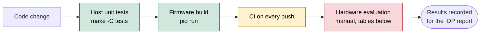
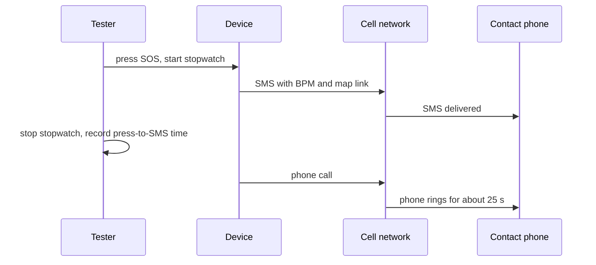

# Testing and evaluation

Two layers: automated tests (done) and hardware evaluation (to do). The hardware plan follows the proposal's three evaluation criteria: automatic alerts, data accuracy, and usability.



Green steps are done and run automatically. CI is configured but has not run yet. The red step needs you and the real hardware.

## Automated (no hardware)

```sh
make -C tests      # host unit tests
pio run            # firmware compiles
```

CI runs both on every push. Coverage is listed in [development.md](development.md). These tests use synthetic signals and a simulated modem, so they show the logic is sound but not that it works on real parts.

## Hardware evaluation plan

Record results in the tables below. Leave a row blank until measured.



### 1. Automatic alerts (reliability and latency)

Press the SOS button 20 times with good signal. Record the time from press to SMS received.

| Metric | Suggested target | Result |
|---|---|---|
| SMS delivered | 20 / 20 | |
| Median press-to-SMS time | under 15 s | |
| Longest press-to-SMS time | under 60 s | |
| SOS during another send is still delivered | yes | |
| Alert with no GPS fix says "Location unknown" | yes | |
| Delivery after temporarily removing signal, then restoring | delivered on retry | |

### 2. Heart-rate accuracy

Compare against a reference such as a validated finger oximeter or smartwatch. Take readings at rest, after light exercise, and with the sensor lifted.

| Condition | Reference BPM | Device BPM | Error | Notes |
|---|---|---|---|---|
| Rest (sample 1) | | | | |
| Rest (sample 2) | | | | |
| After exercise | | | | |
| Sensor lifted | n/a | expect `0` | | |

Suggested target: within ±5 BPM at rest. Tune `PULSE_MIN_AMPLITUDE` if the target is missed.

### 3. Location accuracy

Stand at a known point outdoors and compare the SMS map link to the true position.

| Location | Distance error (m) | Satellites | Notes |
|---|---|---|---|
| Open sky | | | |
| Between buildings | | | |
| Indoors near window | | | |

### 4. High-BPM alert behaviour

| Check | Expected | Result |
|---|---|---|
| BPM below the low threshold for over 10 s | one low-BPM alert | |
| Sensor lifted off skin for 30 s | no alert, `bpm=0` | |
| BPM above threshold under 10 s | no alert | |
| BPM above threshold for over 10 s | one alert | |
| Stays high after alert | no repeat within 5 min | |
| Drops below threshold minus 5, then rises again after cooldown | new alert | |

### 5. Phone call

| Check | Expected | Result |
|---|---|---|
| SOS press | SMS arrives, then the phone rings | |
| Ring duration | about 25 s, then the line is released | |
| Callee rejects the call | device returns to idle, next SMS still works | |
| SOS pressed while the phone is ringing | call dropped, new SMS sent promptly | |
| `CALL_ON_SOS 0` | SMS only, no call | |

### 6. Usability

Ask at least five people to put the device on, then fill in:

| Question | Scale 1–5 | Comments |
|---|---|---|
| Easy to wear | | |
| Easy to understand the SMS | | |
| Easy to trigger SOS | | |
| Confident in the device | | |

## Known gaps to evaluate honestly

- Irregular rhythm is not detected, and a pulse that stops entirely looks like a lifted sensor.
- No false-alarm or missed-event rate has been measured, so no accuracy claim should be made for heart-attack detection.
