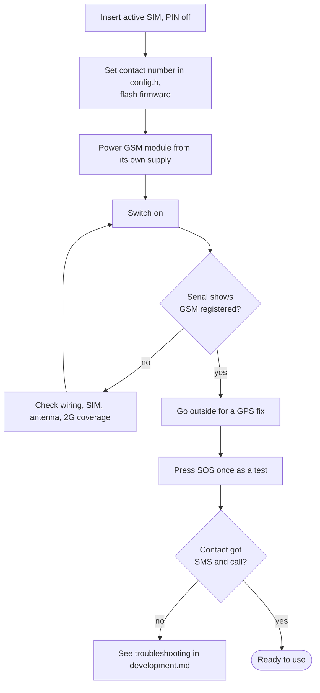
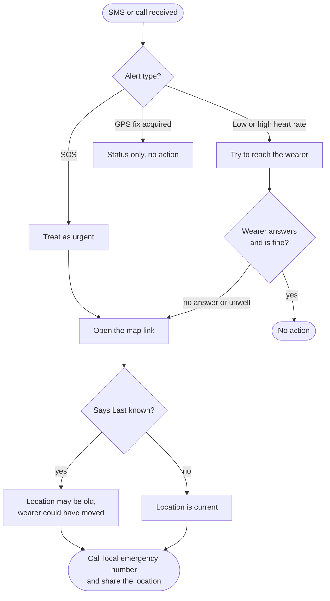

# User guide

For the person wearing the device and the person setting it up.

> **Not a medical device.** HeartSaver can miss events and can raise false alarms. It does not diagnose a heart attack. In an emergency, call your local emergency number.

## Before first use

1. Insert an active SIM with SMS credit. Disable its PIN lock.
2. Set the contact's number in `include/config.h` (see [configuration.md](configuration.md)) and flash the firmware.
3. Power the GSM module from its own supply (see [hardware.md](hardware.md)).
4. Switch on. Wait for the GSM module to register on the network, which can take up to a minute. The serial monitor shows `[GSM] registered, ready`.
5. Go outside with a view of the sky until GPS gets a fix. The first fix can take several minutes.
6. Send a test: press the SOS button once and confirm the contact receives the SMS.

## Wearing it

Keep the pulse sensor against skin with steady, light pressure. Movement and loose contact cause missed beats or noisy readings. If the signal is lost, the device shows no heart rate rather than a wrong one.

## What the alerts mean

| SMS starts with | Meaning |
|---|---|
| `ALERT: SOS - manual button press` | The wearer pressed the button. Treat as urgent. |
| `ALERT: High heart rate` | BPM stayed above the limit (default 90 for 10 seconds). It may be exercise, not an emergency. |
| `ALERT: Low heart rate` | BPM stayed below the limit (default 50 for 10 seconds). Athletes and people asleep can have a low rate. |
| `ALERT: GPS fix acquired` | The device got its first location after switching on. A status message, not an emergency. |

After an SOS, high or low heart-rate SMS, the device **also rings the contact's phone** for about 25 seconds. The SMS has the details: answer or check it. If a newer alert arrives while it is ringing, the call is dropped so that SMS goes out first.

Each SMS also shows `BPM:` (`--` if unknown) and either a map link or `Location unknown (no GPS fix)`. A link prefixed `Last known:` is an old location, so the wearer may have moved.

## If you receive an alert

## Indicators

| Indicator | Meaning |
|---|---|
| LED on | An SMS is being sent or a call is in progress |
| LED off | Idle |

## Limits to be aware of

- It needs cellular signal to send SMS. In poor coverage a send is retried a limited number of times (3 for normal alerts, 10 for SOS), then given up. Press SOS again once you have signal.
- It can only alert one contact number.
- GPS does not work well indoors.
- Exercise or stress can trigger a high-BPM alert, and a naturally low resting rate can trigger a low-BPM alert. Irregular rhythm is not detected.
- Rates below about 30 BPM read as no signal. A pulse that stops completely looks the same as a lifted sensor and does not raise an alert.
- Alerts are not sent to emergency services. Your contact has to act on them.
